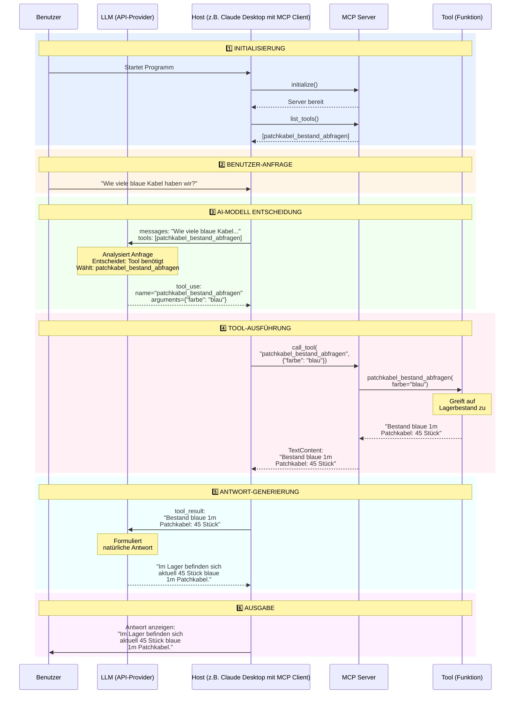

# Sachwissen - Systemarchitektur mit MCP und LLM (API-Provider)


## Detailliertes Sequenzdiagramm



---

## Schritt-für-Schritt Erklärung

### 1️⃣ Initialisierung (einmalig beim Start)

```
MCP Client ──initialize()──> MCP Server
MCP Client <──OK──────────── MCP Server

MCP Client ──list_tools()──> MCP Server
MCP Client <──[Tools]──────── MCP Server
```

**Was passiert:**
- Client startet Server-Prozess (via stdio)
- Server initialisiert sich
- Client fragt verfügbare Tools ab
- Server sendet Tool-Liste zurück

---

### 2️⃣ Benutzer-Anfrage

```
Benutzer ──"Wie viele blaue Kabel?"──> MCP Client
```

**Was passiert:**
- Benutzer stellt Frage
- Client empfängt Frage

---

### 3️⃣ AI-Modell Entscheidung

```
MCP Client ──Anfrage + Tools──> LLM
LLM  ──Analysiert────────> (intern)
LLM ──tool_use─────────> MCP Client
```

**Was passiert:**
- Client sendet Anfrage und Tool-Liste an LLM
- LLM analysiert die Frage
- LLM entscheidet: "Ich brauche das Tool patchkabel_bestand_abfragen"
- LLM gibt Anweisung zurück: Tool ausführen mit Parameter "blau"

**LLM JSON-Response:**
```json
{
  "stop_reason": "tool_use",
  "content": [
    {
      "type": "tool_use",
      "id": "toolu_123",
      "name": "patchkabel_bestand_abfragen",
      "input": {"farbe": "blau"}
    }
  ]
}
```

---

### 4️⃣ Tool-Ausführung

```
MCP Client ──call_tool()──> MCP Server
MCP Server ──Ausführen────> Tool (Python-Funktion)
Tool ──────────Ergebnis──> MCP Server
MCP Server ───Ergebnis───> MCP Client
```

**Was passiert:**
- Client ruft Tool auf Server auf
- Server ruft Python-Funktion auf
- Funktion greift auf Daten zu (LAGER_BESTAND)
- Funktion gibt Ergebnis zurück
- Server verpackt Ergebnis in TextContent
- Server sendet an Client

**MCP Protocol:**
```json
// Request
{
  "method": "tools/call",
  "params": {
    "name": "patchkabel_bestand_abfragen",
    "arguments": {"farbe": "blau"}
  }
}

// Response
{
  "result": {
    "content": [
      {
        "type": "text",
        "text": "Bestand blaue 1m Patchkabel: 45 Stück"
      }
    ]
  }
}
```

---

### 5️⃣ Antwort-Generierung

```
MCP Client ──Tool-Ergebnis──> Claude API
Claude API ──Formuliert────> (intern)
Claude API ──Antwort───────> MCP Client
```

**Was passiert:**
- Client sendet Tool-Ergebnis zurück an Claude
- Claude liest das Ergebnis
- Claude formuliert natürliche Antwort basierend auf Daten
- Claude sendet finale Antwort an Client

**LLM finale Response:**
```json
{
  "stop_reason": "end_turn",
  "content": [
    {
      "type": "text",
      "text": "Im Lager befinden sich aktuell 45 Stück blaue 1m Patchkabel."
    }
  ]
}
```

---

### 6️⃣ Ausgabe an Benutzer

```
MCP Client ──Antwort──> Benutzer (Terminal/UI)
```

**Was passiert:**
- Client zeigt Antwort im Terminal an
- Benutzer sieht die Information

---

## Datenfluss: Vollständiges Beispiel

### Anfrage: "Wie viele blaue Kabel haben wir?"

```
1. BENUTZER → CLIENT
   Input: "Wie viele blaue Kabel haben wir?"

2. CLIENT → LLM
   Request: {
     "model": "claude-sonnet-4-20250514",
     "messages": [{"role": "user", "content": "Wie viele blaue Kabel haben wir?"}],
     "tools": [{
       "name": "patchkabel_bestand_abfragen",
       "description": "Fragt den aktuellen Lagerbestand...",
       "input_schema": {...}
     }]
   }

3. LLM → CLIENT
   Response: {
     "stop_reason": "tool_use",
     "content": [{
       "type": "tool_use",
       "name": "patchkabel_bestand_abfragen",
       "input": {"farbe": "blau"}
     }]
   }

4. CLIENT → MCP SERVER
   MCP Call: {
     "method": "tools/call",
     "params": {
       "name": "patchkabel_bestand_abfragen",
       "arguments": {"farbe": "blau"}
     }
   }

5. MCP SERVER → TOOL
   Python Call: patchkabel_bestand_abfragen(farbe="blau")

6. TOOL → MCP SERVER
   Python Return: "Bestand blaue 1m Patchkabel: 45 Stück"

7. MCP SERVER → CLIENT
   MCP Response: {
     "result": {
       "content": [{"type": "text", "text": "Bestand blaue 1m Patchkabel: 45 Stück"}]
     }
   }

8. CLIENT → LLM
   Request: {
     "model": "claude-sonnet-4-20250514",
     "messages": [
       {"role": "user", "content": "Wie viele blaue Kabel haben wir?"},
       {"role": "assistant", "content": [tool_use_block]},
       {"role": "user", "content": [tool_result_block]}
     ],
     "tools": [...]
   }

9. LLM → CLIENT
   Response: {
     "stop_reason": "end_turn",
     "content": [{
       "type": "text",
       "text": "Im Lager befinden sich aktuell 45 Stück blaue 1m Patchkabel."
     }]
   }

10. CLIENT → BENUTZER
    Output: "Im Lager befinden sich aktuell 45 Stück blaue 1m Patchkabel."
```

---

## Wichtige Erkenntnisse

### Zusammenspiel der Komponenten:

**Anwendungsebene:**
- Benutzer (stellt Fragen)
- LLM (trifft Entscheidungen)

**Infrastructure/Backend:**
- MCP Client (koordiniert)
- MCP Server (verwaltet Tools)
- Tool (führt aus)

### Kommunikationsschichten:

1. **Benutzer ↔ Client:** Terminal/UI
2. **Client ↔ LLM:** HTTPS (Provider API) oder bei ollama HTTP zu localhost:11434
3. **Client ↔ MCP Server:** stdio (Standard Input/Output), Kommunikation (Texteingabe, Textausgabe) zweier Programme Client/Server, wenn verteilt dann HTTP/HTTPS-Streaming.
4. **MCP Server ↔ Tool:** Python-Funktionsaufruf

### Wer übernimmt welche Aufgaben:

- **LLM:** Welches Tool wird benötigt?
- **MCP Client:** Koordination zwischen LLM und Tools (anwendungsspezifische Funktionsaufrufe) (Gern verwendete Analogie: USB-Schnittstelle zwischen LLM und Anwendung)
- **MCP Server:** Tool-Ausführung und in diesem Beispiel auch Datenmanagement
- **Tool:** Funktionen (Daten abrufen, berechnen, API-Calls, Datenbankabfragen, etc.)

---

## Autoren und Urheberrecht
- Created by: Michael Lotter
- Date: 12/2025
- Version: v1.0


<p align="center">
<a href="../11-intro-to-mcp/02_tool.md"></a>
<a href="../11-intro-to-mcp/04_client_llm.md"></a>
</p>